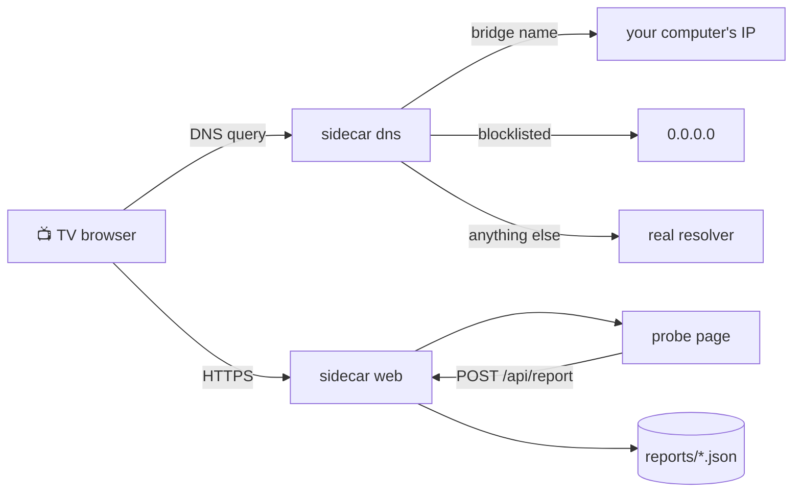

<div align="center">


<br>

[](https://github.com/flavioabbinante/sidecar/actions/workflows/ci.yml)
[](https://www.python.org/)
[](LICENSE)
[](pyproject.toml)
[](#-safety-by-design)
[](#-requirements)
[](CONTRIBUTING.md)

**See what your VIDAA smart TV exposes. See who it talks to. Cut what you don't want.**

[Quick start](#-quick-start) ·
[How it works](#-how-it-works) ·
[Troubleshooting](#-troubleshooting) ·
[Compatibility](docs/COMPATIBILITY.md) ·
[Contributing](CONTRIBUTING.md)

</div>

---

## ✨ What is sidecar?

Smart TVs running **VIDAA OS** (Hisense and related brands) are closed boxes. You can't
see which platform functions the browser exposes, you can't see which servers the TV
contacts when it boots, and the home screen decides for itself what to show you.

**sidecar** is a small command-line toolkit that runs on a computer in your home and
gives you that visibility:

| | |
|---|---|
| 🔍 **Probe** | Opens a page on the TV that lists the platform functions your firmware exposes and records the values of the harmless `Get…` ones. |
| 📜 **Watch** | Acts as the TV's DNS server and logs every name the TV looks up, so you can see what it phones home to. |
| 🔇 **Quiet** | Sinks the names on a blocklist you control: trackers, ad servers, anything you decide. |

It is **pure Python standard library**: nothing to install, no build step, no
background service. Run it when you need it, stop it when you're done.

> [!IMPORTANT]
> Use sidecar only on a TV you own, on a network you control. It is not affiliated with
> or endorsed by Hisense or VIDAA, and a firmware update may stop it from working.

## 🧰 Built with

<p>
  
</p>

Python for the servers, plain HTML and JavaScript for the probe page, OpenSSL for the
one-time certificate, GitHub Actions for tests.

## 🚀 Quick start

### 📋 Requirements

- Python **3.9 or newer**
- `openssl` on your `PATH` (used once, to create the certificate)
- A computer on the **same network** as the TV (tested on Linux)
- The ability to bind ports **53/UDP** and **443/TCP**, and to open them in your firewall

### 📦 Install

```sh
git clone https://github.com/flavioabbinante/sidecar.git
cd sidecar
```

That's all you need: run it straight from the folder with `python3 -m sidecar`.
If you prefer a `sidecar` command on your path:

```sh
pip install .
```

### ▶️ Run it

Find your computer's LAN address (for example `192.168.1.50`), then start two things in
two terminals:

```sh
# terminal 1: the DNS server
sudo python3 -m sidecar dns --ip 192.168.1.50 --log dns.log

# terminal 2: the probe page
sudo python3 -m sidecar web
```

Then, on the TV:

1. Open the network settings and set the **primary DNS** to your computer's address.
   Leave the secondary empty (or `0.0.0.0`, or the same address).
2. Open the browser and go to **`https://vidaahub.com/`**.
3. Accept the certificate warning. It's your own self-signed certificate.
4. The page counts the functions it found and uploads a report. Look in `reports/`.

When you're done, set the TV's DNS back to **automatic** and stop both programs with
`Ctrl+C`.

> [!WARNING]
> If your computer is off while the TV still points at it, the TV can't resolve any
> names and its apps will fail. Always put the DNS back.

<details>
<summary><b>Running without <code>sudo</code> (Linux)</b></summary>

Ports below 1024 are privileged. Instead of `sudo`, you can lower the limit until the
next reboot, and open the ports in the firewall:

```sh
sudo sysctl net.ipv4.ip_unprivileged_port_start=53
sudo firewall-cmd --add-port=53/udp --add-port=443/tcp   # firewalld
```

Restore it afterwards with `sudo sysctl net.ipv4.ip_unprivileged_port_start=1024`.

</details>

## 🔇 Quiet the TV

Restart the TV while `sidecar dns` is running, then see what it contacted:

```sh
python3 -m sidecar summarize dns.log
```

```text
   12  forward  recommend-ui.example
    5  forward  tracker.example
    1  local    vidaahub.com
```

Put the names you want to cut in a text file, one per line (subdomains are included,
hosts-file lines work too), and pass it in:

```sh
sudo python3 -m sidecar dns --ip 192.168.1.50 \
    --blocklist blocklists/example.txt --log dns.log
```

Add **one name at a time** and check the TV still works. Some names that look like
advertising also feed the home screen or the apps. Blocking is by name, so a tracker
served from the same name as real content can't be separated from it.

## 🔬 How it works

The TV's built-in browser only exposes its platform functions to pages loaded from one
vendor domain. With sidecar as the TV's DNS server, that name resolves to your
computer, which serves the probe page over HTTPS.



| Command | What it does |
|---|---|
| `sidecar dns` | DNS server: answers the bridge name locally, blocks listed names, forwards the rest, logs every decision. |
| `sidecar web` | HTTPS server: serves the probe page and stores redacted reports. Creates a self-signed certificate on first run. |
| `sidecar summarize` | Counts the names in a DNS log. |

Run `python3 -m sidecar <command> --help` for every option.

## 🛡️ Safety by design

- **Read-only.** The probe page only calls functions named `Hisense_Get<Something>`.
  sidecar has no code that installs apps, writes files, resets the TV or runs
  commands sent from the network.
- **Reports are redacted.** Values under keys that look like serial numbers, UUIDs,
  device or ad IDs, IP/MAC addresses, tokens and accounts are replaced with
  `<redacted>` before they're written. Still, read a report before you share it.
- **Nothing leaves your network.** sidecar makes no outbound calls except forwarding DNS
  queries to the resolver you choose (`--upstream`, default `1.1.1.1`).
- **Small and auditable.** About 300 lines of Python with no dependencies.

Found a vulnerability? Please read [SECURITY.md](SECURITY.md).

## 🩺 Troubleshooting

<details>
<summary><b>The page says <code>ERR_CONNECTION_REFUSED</code> or the TV can't find the site</b></summary>

The TV is not using sidecar as its DNS. Check that the **primary DNS** shows your
computer's address, that the **secondary is empty or `0.0.0.0`** (a secondary resolver
can answer instead of sidecar), and restart the TV. If the DNS field won't stick, set
the DNS on your router instead.
</details>

<details>
<summary><b>The DNS log shows no lines at all</b></summary>

Nothing is reaching sidecar. Test from another computer with
`dig @192.168.1.50 vidaahub.com +short`; it should print your address. If it times out,
open port **53/UDP** in the firewall.
</details>

<details>
<summary><b>The page opens through the IP address but finds few functions</b></summary>

The TV only exposes most functions to the vendor domain, not to an IP address. Use the
domain name with the DNS set as above.
</details>

<details>
<summary><b>The TV doesn't open the page, or shows a blank screen</b></summary>

The probe page uses <code>async</code>/<code>await</code> and <code>fetch</code>, which very
old TV browsers lack. Also check that `sidecar web` printed its address and that port
**443/TCP** is open.
</details>

<details>
<summary><b>The TV's apps stopped working</b></summary>

Either the TV still points at a computer that is off, or a name you blocked was needed.
Set the TV's DNS back to automatic, then re-add blocked names one at a time.
</details>

## 🗺️ Roadmap

- [ ] A shared, community-reviewed blocklist per region
- [ ] Per-firmware notes in [docs/COMPATIBILITY.md](docs/COMPATIBILITY.md)
- [ ] Optional multi-threaded DNS for several devices
- [ ] Windows and macOS testing

Have an idea? [Open an issue](../../issues/new/choose).

## 🤝 Contributing

Contributions are welcome, and **device reports are the most useful thing you can send**:
which model and firmware you have, and whether the probe worked. See
[CONTRIBUTING.md](CONTRIBUTING.md) and the [Code of Conduct](CODE_OF_CONDUCT.md).

```sh
python3 -m unittest discover -s tests
```

## 🙏 Prior art

The idea of reaching the TV's browser bridge through the vendor domain and a local DNS
entry comes from community projects around VIDAA TVs, such as
[VidaaEdge](https://github.com/weinzii/vidaa-edge) and
[vidaa-appstore](https://github.com/trialuser/vidaa-appstore). sidecar shares no code
with them: it is a separate, read-only design with DNS logging and blocking added.

## 📄 License

[MIT](LICENSE) © 2026 sidecar contributors.
